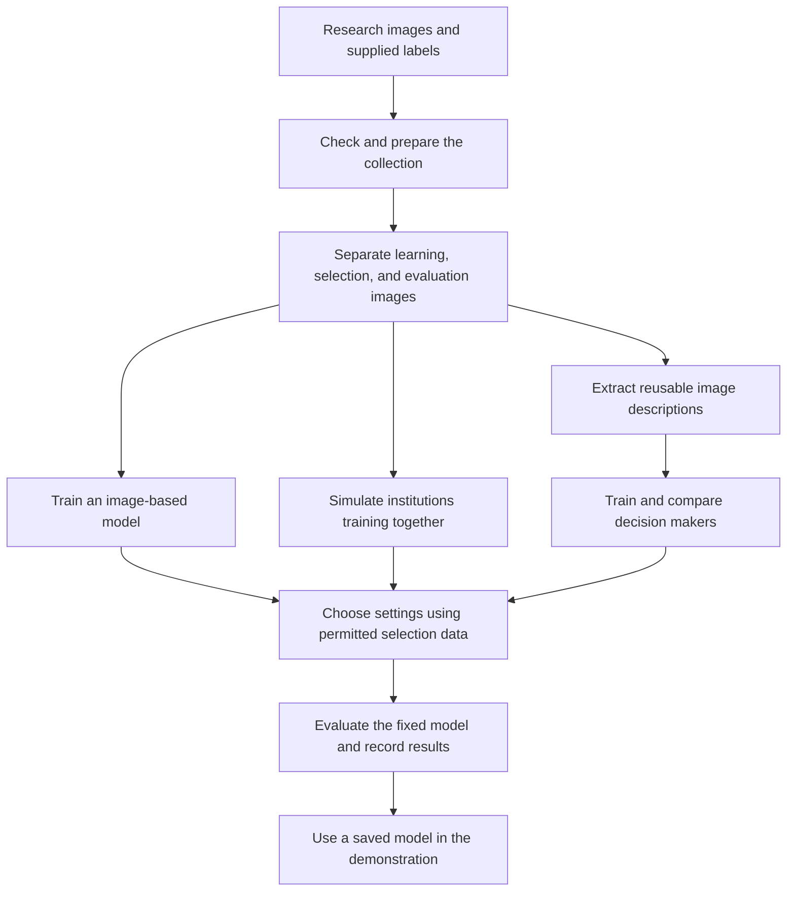

# A teammate's guide to the skin-image research project

This guide explains the workflows on the `issue-fixes` branch, using the project's code, experiment notes, saved results, and the issue-fix verification from 25 October 2026.

**Who this is for:** teammates starting with no knowledge of the project, programming, or machine learning. You can understand the project and discuss its results without learning to write code.

**What you should be able to do afterward:** explain the project, follow a demonstration, distinguish the experiments, read a results report, and ask useful questions before accepting a claim.

This is an academic research prototype for classifying skin-lesion photographs. It is not a clinical diagnosis service.

## Choose your starting point

| Your goal | Start here |
| --- | --- |
| Understand what we are building | Sections 1–3 |
| Give a demonstration | Workflow A in section 4 |
| Understand how a model learns | Workflows B–F |
| Understand the many experiment names | Section 5 |
| Review or present results | Sections 6–7 |
| Understand the fixes and team handoff | Sections 8–10 |
| Check your understanding | Section 11 |

You do not need to run every experiment. Start by understanding the journey of one image.

## 1. What does this project actually do?

The project studies whether a computer can place a dermoscopic photograph—a close-up skin image taken with a specialist imaging tool—into one of seven categories supplied by a research dataset.

It also studies different ways of teaching that computer:

- Teaching from one collection in one place.
- Simulating several institutions learning together.
- Adding privacy protection to training updates.
- Reusing an existing image-reading model and teaching a smaller decision-making model.
- Comparing simpler, larger, and specialist decision-making models fairly.

The seven short labels you will see are `akiec`, `bcc`, `bkl`, `df`, `mel`, `nv`, and `vasc`. You do not need to memorize their medical names to follow the software workflows. The image's supplied category is called its **label**.

### An image reader and a decision maker

Many experiments have two parts:

| Part | Everyday explanation | Name you may hear |
| --- | --- | --- |
| Image reader | Turns a photograph into a numerical description of visual patterns | Backbone, encoder, feature extractor |
| Decision maker | Learns which descriptions tend to belong to each category | Classifier, head, readout |

Imagine a reader making notes about each picture, then a decision maker learning to sort those notes. The notes are numbers rather than sentences.

**EfficientNet** is one image reader used here. **PanDerm** is another, developed for dermatology images. PanDerm has Base and Large versions. A larger reader does not automatically make every decision maker better.

When we say a reader is **frozen**, its learned settings stay fixed during that experiment. We train the decision maker instead. A frozen PanDerm reader alone does not provide this project's seven-category answer: it needs a decision rule, such as a trained classifier or the explicitly labelled nearest-neighbor reference method.

### Training and prediction are different activities

**Training** changes a model using labelled examples. **Prediction**, also called inference, uses an already trained model to answer for an image.

Uploading an image to the demo asks the saved model for a prediction. It does not teach the model a new lesson or improve it automatically.

## 2. The project's overall journey

These are related routes through the project. They are not mandatory steps that every teammate must run in sequence.

### Three learning priorities

| Critical learn: understand first | Simple meaning | Why it matters |
| --- | --- | --- |
| Training versus prediction | Teaching a model versus asking it a question | Explains what the demo actually does |
| Fair data separation | Keep learning examples apart from final evaluation examples | Prevents misleading results |
| Related images | Different photos may show the same lesion | Explains why splitting photos randomly can be unfair |
| Model scores versus evidence | A confident answer is not proof that it is correct | Helps you present results responsibly |
| Privacy scope | Local training and privacy-protected updates are separate ideas | Prevents overstating privacy |

| Major learn: understand next | Simple meaning | Why it matters |
| --- | --- | --- |
| Reusable image descriptions | Read each image once and save the numerical notes | Explains the faster experiment workflows |
| Rare categories | Some labels have many fewer examples | Explains balancing and per-category scores |
| Fair comparison | Compare models on the same agreed questions | Prevents ranking unlike experiments |
| Verification | Check that software runs and that results mean what we claim | Separates working code from good research evidence |

| Minor learn: recognize when needed | Simple meaning | What you need to remember |
| --- | --- | --- |
| Experiment names | Names such as SMOTE, refined, widths, and capacity search | Find their purpose in section 5 |
| File types | Saved models, spreadsheets, reports, and logs | Know which file answers your question |
| Training controls | How long to train and how strongly to discourage memorization | Agree on the experiment question before adjusting them |

## 3. The data: study material, practice exam, final exam

The downloaded full ISIC 2018 Task 3 collection contains **11,720 images**:

| Source collection | Images | How this project uses it |
| --- | ---: | --- |
| HAM10000 training collection | 10,015 | Divided further into learning, selection, and evaluation groups |
| Official validation collection | 193 | Additional evaluation, kept separate from the main learning collection |
| Official test collection | 1,512 | Additional evaluation, reported separately |

The word “training” in the source collection's name does not mean all 10,015 images are used to teach every model here.

### The three internal roles

| Role | Learning analogy | Permitted use |
| --- | --- | --- |
| Training | Study material | Teach the model |
| Validation | Practice exam | Choose among settings or candidate models, according to the experiment's agreed rules |
| Test | Final exam | Evaluate after the choice is fixed |

Some later experiments make choices using smaller practice splits **inside the training group**. The separate validation group then stays outside that tuning process. The experiment report should say which approach was used.

### Why the same lesion must stay together

Suppose one skin lesion was photographed three times. Putting two pictures into study material and the third into the final exam can make the exam easier: the model has already seen a closely related example.

The corrected training workflows keep all images with the same **lesion ID**, the identifier for one lesion, in the same internal group. A lesion ID is not a patient ID. This does not establish that different groups contain different patients.

### There are two important internal split plans

| Experiment family | Training images | Validation images | Internal test images | Detail to remember |
| --- | ---: | ---: | ---: | --- |
| Original EfficientNet experiments, PanDerm Base, and corrected legacy training at the default split seed | 7,014 | 1,509 | 1,492 | Retains all 10,015 HAM images |
| PanDerm Large experiments using the authors' released split | 8,207 | 575 | 1,232 | One source row has an unrecognized split label and is excluded to follow the released recipe |

The extra official collections are reported separately. They do not supply the lesion grouping information needed here to prove that their lesions never overlap other source collections.

**Review habit:** before comparing two numbers, ask, “Were these models answering for the same images under the same evaluation rules?”

## 4. The main workflows

### Workflow A — Demonstrate an existing model

**Purpose:** show how a saved model answers for one image.

**You need:** the prepared local project, a working model with its supporting files, and a sample image from the approved research collection.

1. Open the project folder supplied by the team.
2. If the demo is already running, open **http://127.0.0.1:8501**. This address points to the computer you are using.
3. Otherwise, double-click **`run-local.cmd`**. A developer may need to prepare the environment or choose another port—the numbered address slot—if the default is occupied.
4. Choose a model in the sidebar. Read its description so you know which experiment you are showing.
5. Upload a supported JPG, JPEG, or PNG image.
6. Read the predicted category, displayed confidence score, and category chart.

**What comes out:** a prediction from an existing model. No training occurs.

**How to explain it:** “This model prefers category X for this image.” A confidence display of 91% does not establish a 91% chance that the answer is medically correct. Some experiment scores are adjusted for class selection, and the nearest-neighbor reference uses votes rather than calibrated confidence.

The initial model choice follows saved recommendation rules that favor PanDerm Large models and use validation results. It is not proof of a universal winner across different experiments.

### Workflow B — Obtain and prepare the data

**Purpose:** turn downloaded research files into an organized collection that experiments can use.

1. Obtain the images, supplied category labels, and lesion grouping information.
2. Check that expected files arrived and are readable.
3. Build the inventory connecting each image to its label and identifiers.
4. Assign learning, selection, and evaluation roles under the chosen split plan.
5. Record the assignments so another run can use the same plan.

**What comes out:** prepared images and a **manifest**, the inventory listing each image and its role.

The full-release downloader checks downloaded archives and supports resuming work. The older HAM10000 preparation helper expects source files to be provided manually. These are two preparation routes, not two additional image collections to combine blindly.

Real-image legacy training requires lesion IDs. If an older prepared inventory lost those IDs, preparation must be repeated before training. Downloading and preparation are normally owned by the experiment runner; teammates can review image counts and missing-file messages.

### Workflow C — Learn from a central collection

**Purpose:** create an image-based baseline trained in one place.

1. Use the prepared learning group.
2. Apply the chosen training image variations, such as flips or rotations.
3. Teach the configured model for repeated passes through those examples.
4. Check progress on validation images using consistent image preparation.
5. Keep the selected saved state and evaluate it on the test group.

**What comes out:** a saved model, results, and charts in the legacy training output folders.

A **baseline** is a starting reference model against which other approaches can be compared.

A **CNN**, or convolutional neural network, is one kind of image-learning model. This route supports pretrained readers and a custom CNN. Depending on the choice, a pretrained reader can stay fixed while its decision-making part learns; the custom CNN learns from its starting settings.

This workflow uses one central collection. It is separate from the faster cached-description experiments below.

### Workflow D — Reuse image descriptions and compare decision makers

**Purpose:** compare several ways of making category decisions without rereading every training image for every candidate.

1. Use a fixed image reader to describe each image numerically.
2. Save those descriptions in a **cache**, a reusable store of previous work.
3. Learn any numerical scaling from training descriptions only. Scaling makes the numbers easier for the decision maker to work with.
4. Teach a linear baseline, a neural network, and XGBoost using the same agreed image groups.
5. Choose settings with the allowed selection data, then evaluate saved models.

| Decision maker | Plain-language description |
| --- | --- |
| Linear baseline | A relatively simple rule combining the image-description numbers |
| Neural network | A more flexible set of learned combinations |
| XGBoost | Many small decision trees working together |

**What comes out:** three model candidates, comparison reports, predictions, and supporting records.

These saved feature classifiers are centrally trained. Their presence in a project that also studies federated privacy does not make them federated or differentially private.

For a newly uploaded image, the demo still runs the appropriate image reader before asking the selected decision maker for an answer.

### Workflow E — Simulate institutions learning together

**Purpose:** study federated learning: several participants improving a shared model without collecting their raw training images at the coordinator.

**In this repository, these are simulated participants on the local computer. This is not a live connection to real hospitals.**

1. Divide the learning group among simulated participants, called clients.
2. Give each participant the current shared model.
3. Each participant learns from its assigned examples.
4. Participants return model updates. When the privacy option is enabled, those updates receive the configured privacy treatment.
5. A coordinator combines the updates into a new shared model.
6. Send the shared model back for another round.
7. Save the final shared model and evaluate it separately.

One **round** is one cycle of local learning and combination. One **epoch** is a pass through a participant's training data.

| Term | Meaning in this workflow |
| --- | --- |
| IID | Participants receive broadly similar mixtures of categories |
| Non-IID | Participants receive different category mixtures, representing uneven local collections |
| FedAvg | Combine participants' learned updates without the extra FedProx penalty |
| FedProx | Add a penalty discouraging a participant's model from moving too far from the shared starting model |

**What comes out:** a shared model, round-by-round records, and final evaluation results.

Keeping images local does not, by itself, prove that updates reveal nothing about those images. That is why privacy protection is a separate workflow decision.

### Workflow F — Study privacy and its effect on usefulness

**Purpose:** investigate how privacy-protected updates affect the learned model.

**Differential privacy**, abbreviated DP, adds controlled randomness to training updates to limit the influence of individual training images on the released model.

Think of a participant's **privacy budget** as a ledger covering its entire run. Every round contributes to the ledger. Starting a new round must not erase earlier spending.

1. Decide whether DP is enabled for the federated experiment.
2. Choose automatic noise calibration or an explicit positive noise multiplier.
3. With automatic calibration, plan noise for all configured rounds and local epochs together.
4. Preserve each participant's accounting record as clients are recreated between rounds.
5. Report the accumulated privacy spending alongside evaluation results.
6. For a trade-off study, repeat comparable experiments at different planned privacy settings.

| Setting | Meaning to recognize |
| --- | --- |
| Epsilon, written ε | A numerical privacy-loss bound; smaller is stronger when comparing otherwise comparable guarantees |
| Delta, written δ | A second parameter required to interpret the privacy bound; report it with epsilon |
| Noise multiplier | Controls the amount of randomness relative to the update limit |
| Automatic noise | The software chooses noise for the planned whole-run budget |
| Explicit noise | The supplied amount is used; resulting epsilon is measured and may differ from the target |

**What comes out:** privacy-accounting records and privacy-versus-performance comparisons.

In DP mode, raw training loss and accuracy are not sent as ordinary round metrics, and training uses an unweighted per-image loss. Their absence is expected. Validation and test scores are separate evaluations, not covered by a claim about private training images.

This is training-image accounting within a research simulation. It does not establish patient-level privacy or certify a real institution's deployment.

## 5. The additional experiment workflows

These are branches of the research process. Each should start with a question, use its recorded data plan, and save its results under the correct experiment name.

| Workflow | The question it asks | What changes | What to look for |
| --- | --- | --- | --- |
| Class weighting | Are common categories drowning out rare ones? | Give some training mistakes more importance | Per-category results, not accuracy alone |
| SMOTE | Does adding artificial examples of underrepresented training descriptions help? | Create extra numerical descriptions from existing training descriptions | These are not new real photographs; validation/test examples stay separate |
| Improved multi-view | Does considering different views of an image help? | Use nine prepared views with a frozen EfficientNet reader and tune decision makers | Reported comparisons against the original single-view run |
| Seven specialists | Is a separate “this category or another category?” decision useful for each label? | Train seven binary specialists, then combine their scores | Individual specialist results and the combined seven-category result are different measurements |
| Regularized specialists | Can we reduce memorization and make specialist choices more stable? | Compare controlled complexity, stopping rules, weighting, and a bounded SMOTE variant | Results on examples excluded from fitting, as well as the training gap |
| PanDerm Base extraction | What numerical descriptions does a dermatology-focused reader produce? | Extract and save descriptions with the fixed Base reader | A completion receipt for extraction; this step alone does not train a seven-category classifier |
| PanDerm Base comparison | Which decision rule works with those descriptions? | Compare linear, neural, tree-based, and nearest-neighbor methods | Original internal split and separately labelled nearest-neighbor reference |
| PanDerm paper reference | How closely can we follow the authors' released implementation? | Use the released Large reader, data recipe, and original decision-making method | Disclosed differences between released files and the paper's stated split proportions |
| PanDerm Large comparison | How do several decision makers compare on the released Large-reader split? | Compare the authors' probe and custom linear, neural, and tree-based heads | The shared released split and separate official test results |
| Refined PanDerm models | Do more carefully selected tree settings or a smaller neural head help? | Tune candidates using practice splits inside the training group | Which data chose the settings; later evaluation groups must remain outside that choice |
| Width comparison | How small can the decision-making network be? | Compare half-width, quarter-width, and tiny heads | Performance alongside model size; smaller is not automatically better |
| Capacity search | Does a different amount or kind of decision-making capacity help? | Try a bounded set of simple heads and linear-plus-correction heads | A winner among tested candidates, not proof of the best model possible |
| Balancing ablation | Which part of a combined strategy caused the change? | Compare class weighting and SMOTE separately and together | Matched data and a clear statement of what changed |
| Test-data adaptation diagnostic | What happens if a saved model is deliberately updated using former test examples? | Update a separate model copy on those examples, including continued update steps | Those examples become training data for that copy; their scores are fitting diagnostics |

A **specialist** here is a computer classifier, not a medical professional. A **regularization** rule discourages overly complicated or memorized decisions. **Early stopping** keeps a selected earlier model state when further learning no longer helps the permitted selection score.

A **nearest-neighbor** method looks for a similar stored training example and uses its label. It is a reference-based comparison, not a zero-shot medical answer from the bare reader.

A **fold** is a temporary practice split inside a larger allowed group. Several folds let researchers make choices without using the final test group. Once fold results are used to choose settings, they are tuning evidence rather than an untouched final exam.

The test-data adaptation copies are saved under diagnostics and excluded from the normal app model list. Their post-update scores on the former tests cannot support a claim of improved performance on unseen data.

## 6. How to read a results report

### Start with five questions

1. What exact experiment and saved model produced this report?
2. Which images taught the model, and which images chose its settings?
3. Which group does the reported score describe?
4. What happened to each of the seven categories?
5. What limitations does the report acknowledge?

### Recognize the measurements

| Measurement | Everyday meaning | Question it helps answer |
| --- | --- | --- |
| Accuracy | Share of answers that matched the supplied labels | How often was it right overall? |
| Precision for a category | Among images assigned that category, how many belonged there? | How often were those category predictions correct? |
| Recall for a category | Among images actually in that category, how many were found? | How many category examples were missed? |
| F1 | A combined measure of precision and recall | How well are those two behaviors balanced? |
| Macro F1 | Average F1 giving each category equal importance | Are rare categories receiving attention too? |
| Weighted F1 | Average F1 giving more influence to categories with more examples | How does the result reflect this collection's category mix? |
| F0.5 | A combined score emphasizing precision more than recall | What does performance look like under that chosen emphasis? |
| Balanced accuracy | Average recall across categories | Does overall correctness hide neglected categories? |
| Confusion matrix | A table showing actual categories against predicted categories | Which categories are being confused? |
| Training-to-evaluation gap | Difference between results on learned and excluded examples | Could the model be memorizing its study material? |

**Illustrative example:** imagine a simplified collection with 95 images in one category and five in another. Always answering with the common category achieves 95% accuracy while missing every example of the rare category. That is why the team reads category-level and macro results as well.

A smaller training-to-evaluation gap does not automatically mean a better model: a weak model can perform poorly on both groups.

Some reports include an uncertainty range calculated by resampling lesions. It describes variation for those fixed models and data. It does not include every uncertainty created by trying many training methods or selecting a winner.

An experiment may record a **seed**, a number used to repeat its random choices. Keeping the same split seed helps preserve the image assignments being compared; it does not promise identical numerical results across every computer.

### Write a fair result statement

Use this pattern:

> “In experiment [name], model [name] achieved [metric and value] on [named evaluation group, with image count]. Its settings were chosen using [selection data]. The main limitation is [limitation].”

Avoid presenting “95% accurate” without the model, data group, category behavior, and experiment context. A previously inspected test set is a historical comparison, not a newly untouched final exam.

## 7. Reports, verification, and troubleshooting are different workflows

### Reporting: explain what happened

A report gathers saved predictions and measurements into readable tables and charts. Some reporting scripts also check calculations, model files, and image predictions. Generating a report does not necessarily retrain the model.

Keep the experiment name, image split, model choice, comparison rule, and limits attached to every chart copied into a presentation.

### Verification: check the work

| Check | What it establishes | What it does not establish |
| --- | --- | --- |
| File/inventory checks | Expected images and supporting files are present | Good predictions |
| Software tests | Specific behaviors work for the tested cases | Every possible future input works |
| Synthetic-image smoke test | A small artificial run can complete training and saving | Useful recognition of real lesions |
| Reload-and-predict check | A saved model can be reopened and used | Strong performance on a fresh population |
| Metric recomputation | Saved numbers agree with saved predictions | The original data separation was fair |
| Split audit | Recorded related lesions stay in separate internal roles | Patient-level separation without patient identifiers |
| Browser check | A person can complete the demonstrated screen flow | Clinical suitability |

Synthetic images are generated test pictures, often random pixels. Their purpose is to check the machinery, not to become evidence of useful classification.

### Troubleshooting: describe a problem so someone can reproduce it

| What you notice | Useful information to capture | Who should investigate |
| --- | --- | --- |
| Demo does not open | Address used, launcher message, and whether it worked previously | Developer or local setup owner |
| No saved model is offered | Project copy and experiment expected | Experiment runner |
| A model takes time to load | Selected model, elapsed time, and visible progress/error | Experiment runner; larger readers may need more memory |
| Different reports show different scores | Both experiment names, split names, metrics, and image counts | Research reviewer |
| Privacy settings appear inconsistent | Automatic/explicit mode, planned rounds, and reported epsilon/delta | Experiment runner |
| Training fails | Full error, workflow name, settings, and last successful step | Developer |

Do not treat an error message as a score, or a low score as proof that the software crashed. Keep those questions separate.

## 8. What the issue-fixes branch changed

| Earlier problem | Beginner-friendly explanation of the correction | Why teammates should care |
| --- | --- | --- |
| Privacy accounting restarted each round; an explicit noise setting was unused | Carry forward the privacy ledger and honor the chosen noise mode | Reported privacy spending now follows the run rather than a single isolated round |
| Related lesion photos could enter different legacy data groups | Assign related photos together before training | Reduces an unfair advantage in evaluation |
| The custom CNN could not accept the configured image size | Add an image-summary step that fits the existing decision-making layer | The configured 224-pixel workflow runs while retaining the original 128-pixel saved-state layout |
| Validation preparation could overwrite training augmentation | Give each role its own dataset settings | Practice and exam preparation no longer switch off training variations |
| Choosing FedAvg still applied the FedProx penalty | Apply the penalty only when FedProx is selected | The named experiment matches the behavior being tested |

Related changes make failed federated rounds fail clearly, retain all classes during uneven participant assignment, and keep smoke-test models out of the normal demonstration output folder.

At the issue-fix verification, **42 software tests passed**, including two-round federated simulations with and without privacy protection. This is a dated software-verification result, not a claim of clinical validation.

The corrections affect subsequent training. Historical models and results do not change automatically because the source code was fixed. Regenerate legacy CNN/federated results through corrected training before presenting them as corrected-run evidence.

## 9. Where to find things

### The project folders

| Location | What it is in ordinary language |
| --- | --- |
| `data/raw/` | Downloaded source images and archives |
| `data/processed/` | Organized inventories and supplied labels |
| `data/features/` | Reusable numerical image descriptions |
| `outputs/feature_models/` | Saved feature-model experiments, predictions, and reports |
| `outputs/models/` | Saved models from the legacy image-training routes, when generated |
| `outputs/diagnostics/` | Investigation and special-purpose experiment results |
| `artifacts/` | Verification evidence, downloaded resources, and local working records |
| `scripts/` | Programs that start workflows |
| `tests/` | Automated behavior checks |
| `config.yaml` | Shared settings for the legacy image-training routes; feature experiments also have their own recorded settings |

A saved model state is often called a **checkpoint**. A **log** records messages from a run. A CSV is a table that spreadsheet software can open. An experiment **receipt** records what files and settings a run used; a file fingerprint helps detect unexpected changes.

### Workflow launchers and references

These names help you ask the right person to run a workflow. They are not a checklist of programs every teammate must execute.

| Goal | Existing launcher or program |
| --- | --- |
| Open the demonstration | `run-local.cmd` |
| Prepare the full release | `scripts/download_full_isic.py`; `train-all.cmd` also requests preparation/download before training |
| Prepare manually supplied HAM files | `scripts/download_data.py` |
| Explore labels and sample images | `notebooks/exploration.ipynb` |
| Train the central image-based baseline | `scripts/train_centralized.py` |
| Train the simulated shared model | `scripts/train_federated.py` |
| Evaluate or compare legacy image models | `scripts/evaluate.py`, `scripts/compare.py` |
| Run a privacy trade-off experiment | `scripts/experiment_privacy_utility.py` |
| Train the initial three feature classifiers | `train-all.cmd` or `scripts/train_feature_models.py` |
| Compare a baseline with its SMOTE experiment | `scripts/compare_feature_runs.py` |
| Train the multi-view experiment | `train-improved.cmd` |
| Separate balancing effects | `scripts/ablate_smote.py` |
| Train seven specialists | `train-specialists.cmd` |
| Compare regularized specialists with/without SMOTE | `train-regularized-specialists.cmd` |
| Extract PanDerm Base descriptions | `extract-panderm.cmd` |
| Train PanDerm Base decision makers | `train-panderm.cmd` |
| Attempt the released paper recipe | `reproduce-panderm-paper.cmd` |
| Train the PanDerm Large comparison | `train-panderm-large.cmd` |
| Train refined, narrower, or capacity-search heads | `train-panderm-refined.cmd`, `train-panderm-widths.cmd`, `train-panderm-capacity.cmd` |
| Inspect the fixed linear reference on training folds | `scripts/check_panderm_linear_cv.py` |
| Study deliberately adapted diagnostic copies | `scripts/adapt_panderm_once.py`, `scripts/report_adaptation_steps3_5.py` |
| Generate experiment reports | The matching `scripts/report_*.py` program |
| Perform saved-model checks | The matching `scripts/verify_*.py` program and automated tests |

Older subset download helpers also exist. A small subset can help investigate software, but it must not be presented as the full-release experiment. Use the full-release preparation workflow when that is the experiment being described.

For operator instructions, use [LOCAL_SETUP.md](LOCAL_SETUP.md). For detailed experiment recipes and result locations, use [TRAINING.md](TRAINING.md). For the project overview, use [README.md](README.md). The notebook is for guided exploration; it is not a requirement for operating the demo.

## 10. How teammates can work together

### Useful ownership roles

| Role | Typical contribution |
| --- | --- |
| Presenter | Demonstrates a named saved model and explains what its scores mean |
| Experiment runner | Prepares data, runs the agreed workflow, and keeps the records |
| Results reviewer | Checks data roles, fair comparisons, rare-category behavior, and limitations |
| Developer | Changes code, investigates failures, and verifies the change |

One person can hold several roles. The point is to make ownership clear before a long run begins.

### Before starting an experiment

Agree on the question, the data split, which settings may change, how the winner will be chosen, where results will be saved, and who is responsible for the run. Give a new experiment a clear output location; the default location is not automatically a fresh copy for every run.

Do not start duplicate training jobs just because a screen is quiet. Some training and extraction steps take time; check the existing run's log with its owner first.

### Before sharing a result

Attach the experiment name, model, data roles/counts, settings-selection rule, report location, verification performed, and limitations. If a model was updated using former test images, say so explicitly.

### Before handing the project to another teammate

**Git** records changes to the project code and documentation. A **branch** is a named line of that work, such as `issue-fixes`. A **commit** is a saved set of changes in that history. Editing files locally does not, by itself, make those edits available on a teammate's computer.

Share the correct code version and instructions. Confirm that required images, pretrained readers, saved classifiers, and supporting files are available on the teammate's computer. Large data, local Python environments, and saved outputs are excluded from ordinary Git tracking here; switching to a code branch does not automatically download them.

Use the shared `issue-fixes` branch to obtain this guide and the corrections. For future changes, commit and push the intended files before expecting another teammate's copy of the branch to contain them.

## 11. Practice: explain it back

Try answering these before reading the suggested answers.

1. A teammate uploads a picture twice. Has the demo trained twice?
2. Why should three photographs of one lesion stay in the same internal data group?
3. A classifier gets high overall accuracy but misses a rare category. Which results should you inspect next?
4. Does a centrally trained PanDerm classifier inherit privacy protection just because this repository also has a DP experiment?
5. Why must the privacy ledger survive a new federated round?
6. If a model learns from former test images, can its score on those images still be described as unseen-data performance?
7. Can two internal-test scores be ranked fairly when their experiments used different image splits?
8. After a code fix, do old saved metrics become corrected-run results automatically?

**Suggested answers**

1. No. The saved model made predictions; the upload flow does not train it.
2. Related pictures can give away information about the held-out example. Grouping keeps that advantage out of the internal evaluation.
3. Inspect category-level recall, precision/F1, macro F1, balanced accuracy, and the confusion matrix.
4. No. Privacy depends on the actual training workflow and accounting used for that model.
5. Earlier participation still contributes to privacy spending. A new round does not erase that history.
6. No. For that updated copy, they are training examples and their scores are fitting diagnostics.
7. Not as a controlled, like-for-like comparison. Check matched evaluation data and protocols first.
8. No. Rerun the corrected training and evaluation process to produce corrected-run evidence.

## Next 3 Learning Moves

1. **Follow one prediction:** open the demo with the team, select a named model, use a sample image, and explain the reader → decision maker → displayed result journey.
2. **Read one report together:** identify its experiment, training/selection/test roles, macro F1, weakest category, and main limitation. Write a result statement using section 6's pattern.
3. **Compare two workflow plans:** explain how a centrally trained feature classifier differs from a federated DP run, including where learning happens, what is exchanged, and what evidence each produces.
